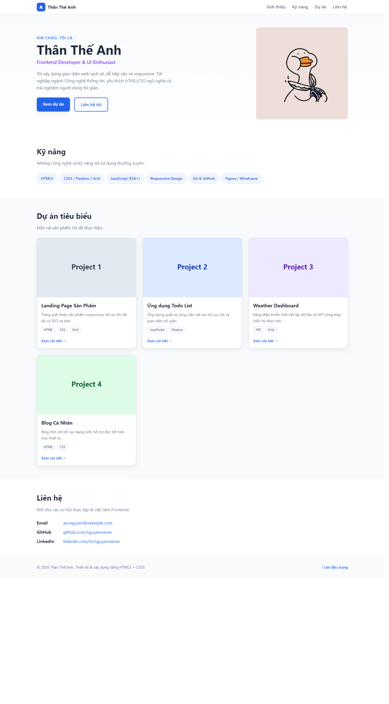
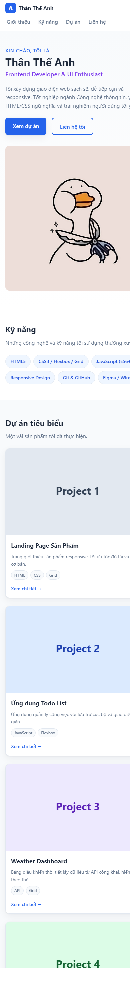

# Báo cáo kiểm thử

## Thông tin kiểm thử

- **Đối tượng:** Website portfolio/CV tĩnh.
- **Ngày kiểm thử:** 27/10/2026.
- **Cách kiểm thử:** Mở `index.html` bằng Chrome chạy cục bộ; chụp giao diện ở viewport desktop 1440 × 2600 px và điện thoại 390 × 3000 px. Rà soát mã HTML/CSS hiện có.
- **Phạm vi:** Kiểm tra hiển thị và rà soát tĩnh; không kiểm thử xâm nhập, không triển khai lên máy chủ thật và không chạy HTML/CSS validator hoặc linter.

## Kết quả theo tiêu chí

| # | Tiêu chí | Kết quả | Minh chứng và nhận xét |
|---|---|---|---|
| 1 | Tính đúng đắn | Đạt có điều kiện | Trang hiển thị các phần Giới thiệu, Kỹ năng, Dự án, Liên hệ và chân trang trong ảnh desktop. Các dự án và thông tin liên hệ vẫn có dữ liệu mẫu; những liên kết dự án, GitHub và LinkedIn dùng `#`, nên chưa dẫn đến nội dung thực tế. Xem [ảnh desktop](./screenshots/desktop.png). |
| 2 | UI/UX | Chưa đạt hoàn toàn | Bố cục desktop hiển thị đầy đủ. Ở viewport 390 px, ảnh điện thoại cho thấy một số nội dung ở phần giới thiệu và chip kỹ năng bị cắt ở mép phải; cần kiểm tra và điều chỉnh độ rộng các phần tử để nội dung không tràn khỏi màn hình. Xem [ảnh điện thoại](./screenshots/mobile.png). |
| 3 | Khả năng vận hành - xử lý lỗi | Đạt một phần | Trang tĩnh mở được từ `index.html`, stylesheet và ảnh đại diện hiển thị trong ảnh chụp. Website không có JavaScript, backend hoặc biểu mẫu nên không có luồng xử lý lỗi động để kiểm tra; chưa thử tình huống thiếu tệp, liên kết ngoài hoặc lỗi khi chạy qua HTTP. |
| 4 | Bảo mật | Đạt theo rà soát tĩnh | Trong HTML đã rà soát không thấy script, biểu mẫu, API hoặc thư viện bên thứ ba được nhúng. Đây không phải kiểm thử xâm nhập; các liên kết và email mẫu cần được thay bằng thông tin đã xác nhận trước khi công khai. |
| 5 | Chất lượng mã nguồn | Đạt một phần | HTML dùng các vùng nội dung ngữ nghĩa; CSS có biến dùng chung, bố cục mobile-first, breakpoint và hỗ trợ `prefers-reduced-motion`. Chưa chạy validator/linter. Hiện tượng nội dung bị cắt trên màn hình nhỏ cần được xử lý. |
| 6 | Khả năng triển khai | Đạt có điều kiện | Website không cần bước build hay cài package và mở được trực tiếp bằng trình duyệt. README có hướng dẫn chạy máy chủ tĩnh/Docker, nhưng các cách triển khai đó chưa được thực thi hoặc xác nhận trong lần kiểm thử này. |

## Ảnh minh chứng

### Desktop — 1440 × 2600 px

### Điện thoại — 390 × 3000 px

## Kết luận

Trang tĩnh mở được và thể hiện các khu vực nội dung chính. Trước khi phát hành nên sửa hiện tượng tràn/cắt nội dung ở viewport điện thoại, thay thông tin mẫu và liên kết `#`, sau đó kiểm thử lại điều hướng, các trường hợp tài nguyên bị thiếu và cách triển khai qua máy chủ web.